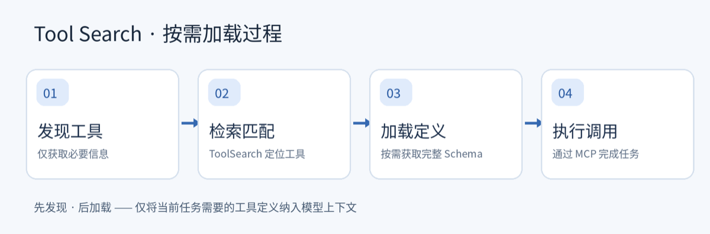

最近，我把滴答清单的 MCP 接入了 Claude Code，想让 AI 帮我创建待办、安排提醒和整理任务。

接入后，我发现它一共提供了 **58 个工具**。

问题也随之而来：**模型每次执行任务前，都要把这 58 个工具的完整定义读一遍吗？**

工具定义不只有一个名称，还包括功能描述和参数结构（Schema）。如果几十甚至上百个工具全部进入上下文，即使最后只用到一两个，也会带来不小的 Token 开销。

于是我查看了 Claude Code 的请求日志。结果比想象中更有意思：**58 个工具中，初始完整加载的数量是 0；搜索之后，也只加载了 3 个。**

这背后的机制，就是 **Tool Search**。

---

## 🔎 工具不必一次全部塞进上下文

常见的工具调用方式，是先把所有工具定义交给模型，再让模型从中选择。工具数量不多时，这样做简单直接；但随着 Agent 接入越来越多的外部系统，工具定义本身也会成为上下文负担。

Tool Search 换了一种思路：把工具的**发现**和**使用**拆开。

模型先知道有哪些工具可供查找。等具体任务出现后，它再搜索相关工具，加载完整描述和参数结构，然后执行调用。

比如，当我说“下午 3 点提醒我买菜”，模型不必提前掌握滴答清单全部 58 个工具的用法。它只需要识别出“创建提醒”的需求，找到相关工具，读取 Schema，再完成调用。

其核心流程可以归纳为：

> **发现工具 → 检索匹配 → 加载定义 → 执行调用**

这里的加载粒度不是整个 MCP Server，而是单个工具。因此，MCP 提供的工具变多，并不意味着每次请求都要加载更多完整定义。

---

## 🧪 请求日志里发生了什么

为了验证这个过程，我记录了一次通过滴答清单 MCP 创建提醒事项的 API 请求，并对比了工具搜索前后的内容。

实验结果如下：

| 观察维度 | 实测结果 |
|---|---:|
| MCP 提供的工具数量 | **58** |
| 初始加载的完整 MCP 工具定义 | **0** |
| 搜索后加载的工具定义 | **3** |
| 最终实际调用的 MCP 工具 | **2** |

在初始请求里，Claude Code 把可用工具名称列在环境说明中，同时明确标注：`Their schemas are NOT loaded`。也就是说，模型知道这些工具存在，但它们的完整参数结构还没有进入上下文。

随后，模型通过 `ToolSearch` 查找所需工具。下一次请求中，顶层 `tools` 数组从 13 项增加到 16 项，新增的正是 3 个相关工具的完整定义。

最后，模型调用其中 2 个工具，完成了任务创建。

整个过程可以概括为：

> **58 个工具处于可发现状态，但只有当前任务需要的少数工具获得了完整定义。**

需要说明的是，这次实验运行在 Claude Code 接入 DeepSeek Flash 的环境中。它反映的是这一环境下的实际行为，不代表所有 MCP 客户端和模型都会采用相同实现。

---

## 🧩 工具能否被准确找到，变得更重要了

按需加载缓解了上下文压力，但也带来了新的关键问题：**模型能不能准确找到需要的工具？**

如果检索结果不准，再完善的加载机制也很难发挥作用。

当工具规模进一步扩大，搜索方式也需要随之升级。除了关键词匹配和 BM25，还可以借助 Embedding 做语义检索：为工具名称和描述建立索引，再根据当前任务召回最相关的工具。

这与 RAG 在思想上具有一致性：

> **不再预先容纳全部信息，而是在需求出现时，有选择地引入相关内容。**

---

## 💡 Tool Search 真正管理的是上下文

Tool Search 的价值不只是节省 Token。它改变了 Agent 组织外部能力的方式：工具可以不断增加，但完整定义不必一直占据模型的上下文。

当然，按需加载并不等于零成本。工具发现、检索、Schema 加载和执行结果仍会占用上下文。最终能节省多少，还取决于工具规模、检索策略和客户端实现。

但这次实验至少说明了一点：衡量 Agent 的工具成本，不能只看它接入了多少工具，还要看这些工具如何进入上下文。

> **真正值得关注的，不只是 Agent 拥有多少工具，而是它如何在适当的时机，将必要的信息交给模型。**

从这个角度看，Tool Search 也是 Context Engineering 的一个具体实践：**在有限的上下文里，只在需要的时候提供需要的信息。**
