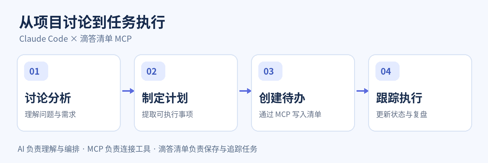

我们在工作中经常会遇到这样的情况：一场项目讨论结束，方案逐渐清晰，工作计划也已经整理成文档，但真正开始执行之前，还需要把其中的行动事项逐条录入任务管理工具。

这看似只是最后一步，却往往意味着重复整理信息、设置截止日期、分配优先级。有时，计划已经写得足够完整，待办事项却迟迟没有同步，最终停留在文档里。

**既然 AI 已经参与了讨论和规划，能否让它顺势完成后续的任务创建？**

最近，我尝试将滴答清单官方 MCP 接入 Claude Code，发现这恰好是 Agent 值得发挥作用的场景。

---

## 🔌 01｜让 AI 连接任务管理工具

滴答清单已经提供 MCP Server，我们可以直接将它接入 Claude Code，无需自行开发接口。

在终端执行：

```bash
claude mcp add --transport http dida365 https://mcp.dida365.com
```

随后启动 Claude Code，输入 `/mcp`，按照提示完成浏览器授权，即可让 Agent 获得相应的任务管理能力。

连接完成后，可以先用一个简单的请求验证：

> 📋 帮我查看今天尚未完成的任务。

如果能够正常读取滴答清单中的待办信息，就说明连接已经生效。

MCP 的意义在于打通 Agent 与外部工具之间的边界。模型负责理解意图和组织任务，滴答清单则负责存储任务、管理状态和安排提醒。

---

## 🧠 02｜让计划自然转化为待办

相比让 AI 创建一个简单提醒，我更感兴趣的是将任务管理嵌入已有的工作流程。

例如，在 Claude Code 中分析一个项目，经过几轮交流，最终形成了一份实施计划，明确了需要完成的功能、推进顺序和预期时间。

过去，这些内容通常会停留在 Markdown 文档中。要真正开始执行，还得重新打开滴答清单，将其中的行动事项逐条创建。

现在可以直接对 Agent 说：

> 根据刚刚讨论的方案，整理一份实施计划，并将其中需要执行的事项创建到滴答清单。保留任务之间的先后关系，尚未明确的截止时间先不要自行填写。

Agent 可以结合对话上下文提取行动项，整理任务标题和说明，必要时拆分复杂任务，再通过 MCP 将待办写入滴答清单。

整个过程由此形成一个自然的衔接：

**讨论问题 → 制定计划 → 提取行动项 → 创建待办**



这意味着，工作计划不再只是静态的文字记录，而可以进一步转化为能够持续跟踪的任务。

当然，创建之前仍然适合让 Agent 展示待办清单，确认任务划分和时间安排，避免把讨论中的设想误当成已经确定的工作。

---

## 🗂️ 03｜让 Agent 参与日常工作流

项目计划只是其中一种场景。接入滴答清单之后，Agent 还可以协助完成日常任务管理中许多重复性的工作。

| 场景 | Agent 可以协助完成的工作 |
|---|---|
| 📝 项目讨论 | 将结论整理成任务，形成后续行动清单 |
| 📥 想法收集 | 将零散记录拆分为结构化待办 |
| ☀️ 每日规划 | 汇总今日任务，梳理处理顺序 |
| 🔄 进度同步 | 根据工作进展更新任务状态 |
| 📊 阶段复盘 | 汇总完成情况与遗留事项 |

例如，完成一次技术调研后，可以让 Agent 将发现的问题、尚待验证的假设和下一步工作整理出来，分别创建为待办。等到下次继续研究时，再读取这些任务，便能够更快地恢复工作上下文。

这种协作方式的价值，并不是把每一步都自动化，而是减少信息在不同工具之间流转时产生的重复劳动。

---

## ⚙️ 04｜从任务清单到工作闭环

传统的待办应用擅长记录任务、管理日期与状态，却很难主动理解一段复杂讨论背后的行动意图。

大语言模型恰好具备文本理解与信息组织能力，而 MCP 使这种能力可以进一步作用于真实的任务系统。

两者结合之后，就可以建立一条相对完整的工作链路：

> **分析与讨论 → 制定计划 → 创建任务 → 跟踪进展 → 更新清单**

其中，Agent 承担信息整理与任务编排，滴答清单提供持久化记录和状态管理。对于需要修改或删除大量任务的操作，则应当保留人工确认，确保系统中的任务始终反映真实意图。

此外，MCP 解决的是工具连接问题，并不意味着 Agent 会自动在后台持续追踪任务。如果希望定时检查进度、主动提醒或周期性生成报告，仍然需要结合额外的调度与自动化机制。

---

## 💡 05｜一点思考

过去，我们通常先完成工作，再花时间维护任务管理工具。记录、分类、调整和同步，往往成为工作之外的另一项工作。

而当 Agent 能够同时理解讨论内容、制定行动计划并操作外部任务系统时，任务管理就有机会融入工作本身，而不再是一个独立的整理环节。

**它真正减少的，不只是创建待办时的几次点击，而是从形成计划到启动执行之间的信息转换成本。**

当然，AI 并不能替我们决定所有事情的优先级，也不能保证每一次任务拆分都准确。但它可以承担那些规则相对明确、重复性较高的整理工作，让我们把更多注意力留给真正需要判断和创造的部分。

或许，这正是 Agent 与个人效率工具结合最值得期待的方向：**让计划更容易落地，让执行更自然地延续。**
