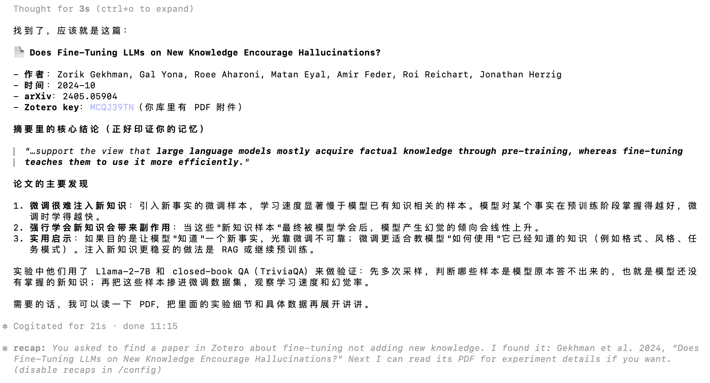

如果你平时经常看论文，应该对 Zotero 不陌生。它确实很好用，收藏论文、管理 PDF、整理笔记都很方便。但时间一长，文献越攒越多，想找之前收藏的某篇论文，有时候还得翻上半天。

我就在想： **既然现在 AI 已经可以帮我们处理各种任务，能不能直接让它操作 Zotero？**

于是，我写了一个 **Zotero Skill**，让 Claude Code 等 AI Agent 可以直接查询和管理本地 Zotero 文献库。

## 📚 一句话，让 AI 帮你找论文

比如，我只记得之前收藏过一篇关于“微调大模型可能导致幻觉”的论文，却忘了标题，就可以直接问 AI：

> 帮我在 Zotero 里找一下，有没有一篇论文讲的是微调大模型学习新知识，反而容易产生幻觉？

AI 就能找到对应的论文，并整理出标题、摘要和主要结论。

除了搜索，还可以让 AI 根据作者、年份、标签筛选文献，读取笔记、摘要，以及已索引的全文。经过授权后，也能帮忙修改文献信息、添加标签、整理分类。

以前需要自己在 Zotero 里反复搜索、点击，现在可以直接用自然语言完成。

## 🔧 一个文件就够了

其实，Zotero 本身就提供了 **Local API**，允许其他程序访问本地文献库。

我只是把这些接口的使用方法写成了一份 Skill，让 AI 知道该怎么调用。

整个 Skill 只有一个 `SKILL.md` 文件，不需要安装额外的 Zotero 插件，也不用配置 MCP Server 或编写 Python 脚本。AI 直接通过
`curl` 命令与 Zotero 通信即可。

另外，我还做了一个小优化： **需要什么信息，就只保留什么信息。**

比如，搜索论文时先返回标题，需要了解内容时再获取摘要，确实要分析全文时才进一步读取。这样既能减少无关信息，也能节省 Token。

## 🚀 怎么使用？

首先，在 Zotero 的 **设置 → 高级**中开启“允许此计算机上的其他应用程序与 Zotero 通信”。

然后，下载 Skill 文件，直接交给 Claude Code，让它帮忙安装：

> 帮我把这个 Zotero Skill 安装到合适的目录下。

AI 就可以自动创建目录、复制文件，完成安装。

安装完成后，保持 Zotero 正在运行，就可以直接对 AI 说：

> 帮我查看 Zotero 中最近收藏的 10 篇论文，整理一下标题和研究内容。

---

## 写在最后

这个 Skill 没有用到什么复杂技术，只是利用 Zotero 已经提供的接口，让 AI 能够直接帮我处理文献。

**Zotero 负责管理文献，AI 负责查找和整理，Skill 则负责把两者连接起来。**

有时候，真正实用的 AI 工具，并不需要多么复杂。

如果你也经常使用 Zotero，可以试试这个 Skill。

**公众号后台回复「Zotero」，即可获取。**
