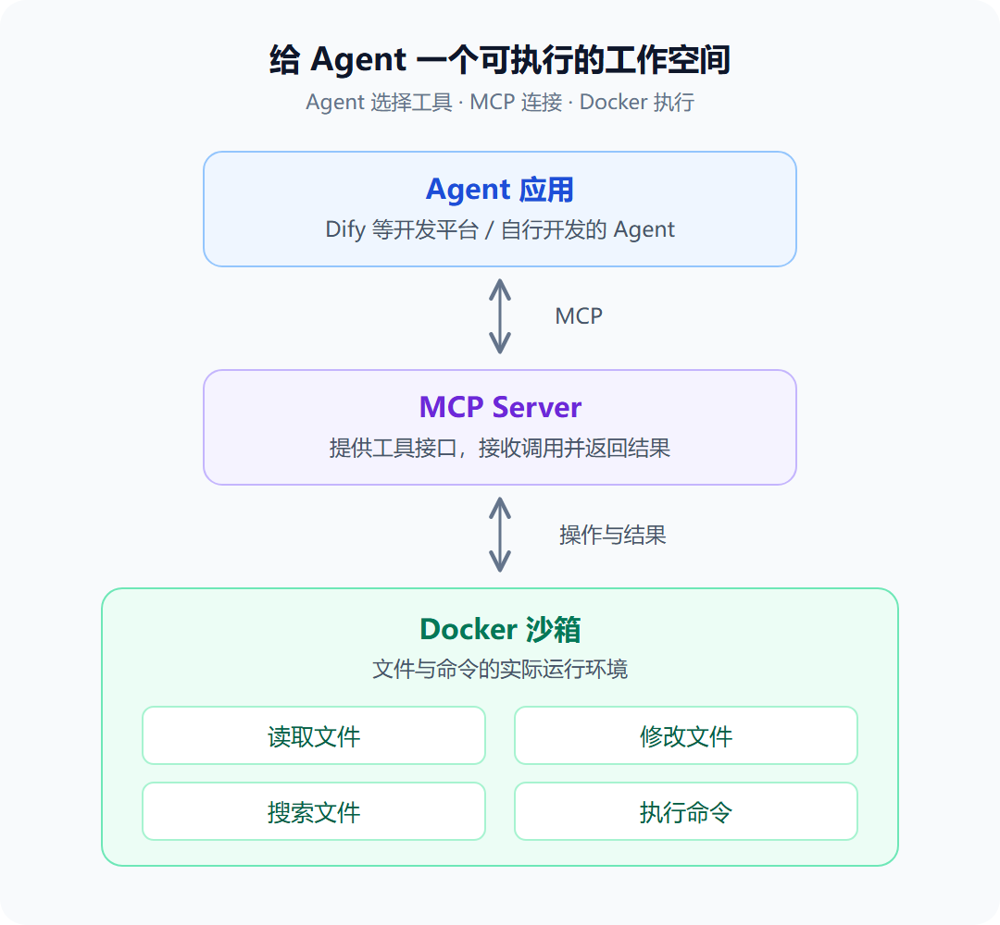

用 Agent 处理日常工作时，我们往往希望它能直接整理表格、分析数据，最后生成一份可以使用的 Excel 报表。

Claude Code 这类工具已经整合了这些能力。但当我们使用 Dify 等 Agent 开发平台，或者自己搭建 Agent 时，该如何为它提供类似的工作空间？

**关键是为 Agent 接入一套可以读写文件、执行命令的环境。**

开源项目 **langchain-docker-backend** 提供了一种实现方式：用 Docker 承载工作空间，再通过 MCP，将容器中的文件操作和命令执行能力提供给 Agent。

---

## 🤔 为什么 Agent 需要一个执行环境？

以整理销售数据为例，Agent 需要先找到各月的原始表格，了解字段和统计口径，再合并数据、计算指标，最后生成汇总表和图表，并核对结果。

要完成这个过程，除了模型的理解和规划能力，还需要几类基础工具：

- 📖 **读取**：查看文件和目录。
- ✏️ **修改**：创建文件、更新内容。
- 🔍 **搜索**：查找文件和代码内容。
- ⚡ **执行**：运行处理程序，完成数据清洗、统计和文件生成。

这些工具需要一个实际的运行环境：文件放在哪里，命令在哪里执行，结果又保存到哪里。

对于 Dify 这类 Agent 开发平台，或自行开发的 Agent 应用，可以将工具和执行环境独立封装，再通过 MCP 接入。这样，不同应用就有机会复用同一套基础能力。

---

## 🧩 通过 MCP，把 Docker 变成 Agent 的工作空间

这个项目用 Docker 创建工作空间，由 MCP Server 对外提供工具接口。Agent 调用工具后，具体的文件操作和命令执行在容器中完成，结果再返回给 Agent。

整个过程可以用一张图来理解：



这里面有三个角色：

- **Agent 应用**：结合模型理解需求、选择工具，并根据结果决定下一步。Dify 是搭建这类应用的一种平台。
- **MCP Server**：将沙箱中的能力封装为工具，接收调用并返回结果。
- **Docker 沙箱**：提供实际操作文件和运行命令的环境。

项目目前提供了 7 个 MCP 工具：

| 工具 | 功能 |
|---|---|
| `ls` | 查看文件和目录 |
| `read` | 读取文件 |
| `write` | 创建和写入文件 |
| `edit` | 修改文件内容 |
| `glob` | 查找文件 |
| `grep` | 搜索文件内容 |
| `execute` | 执行 Shell 命令 |

这 7 个工具覆盖了查看、读写、搜索和执行等基础操作，Agent 可以根据任务需要组合使用。

---

## 💡 接入之后，可以做什么？

假设我们已经将这个 MCP Server 接入一个支持 MCP 工具调用的 Agent，并提出需求：

> 帮我整理工作目录中最近三个月的销售 Excel 表格，按月份和产品统计销售额，生成一份包含汇总表和趋势图的 Excel 报表，再用几句话说明主要变化。

Agent 可以按下面的流程推进任务：

1. **查找表格**：找到最近三个月的销售文件，确认需要处理哪些数据。
2. **检查数据**：了解日期、产品、销售额等字段，检查缺失值、重复记录和格式差异。
3. **汇总分析**：统一统计口径，按月份和产品汇总销售额，计算变化幅度。
4. **生成报表**：将整理后的数据、汇总结果和趋势图保存到新的 Excel 文件中。
5. **核对并说明**：检查汇总金额与原始数据是否一致，再说明主要变化和需要关注的问题。

如果发现某张表的日期格式不同，或汇总结果对不上，Agent 可以根据检查结果调整处理方式，再次生成报表。遇到无法确定的统计口径，则需要向用户确认。

类似的任务还包括合并问卷结果、分析收支明细、整理库存清单。用户提出的是工作目标，Agent 再组合底层工具完成处理，最终交付文件和分析结果。

这里的 Excel 处理和图表生成，需要容器中具备相应的处理程序或依赖。MCP 工具提供的是文件操作和命令执行入口，具体分析仍由 Agent 调用这些程序完成。

---

## ⚙️ 如何启动这个 MCP Server？

项目已经封装了 Docker 沙箱和 MCP 工具，下面是一个最小启动示例。

首先，需要安装并启动 Docker，然后安装项目：

```bash
pip install 'langchain-docker-backend[mcp]'
```

拉取默认 Docker 镜像：

```bash
docker pull python:3.13-slim
```

接下来，创建一个 `mcp_server.py` 文件：

```python
from langchain_docker_backend import DockerSandbox
from langchain_docker_backend.mcp import create_mcp_server

with DockerSandbox() as sandbox:
    create_mcp_server(sandbox).run(
        transport="streamable-http",
        host="0.0.0.0",
        port=8000,
    )
```

启动服务：

```bash
python mcp_server.py
```

这样，一个提供文件操作和命令执行能力的 MCP Server 就启动了。

默认情况下，可以通过下面的地址访问：

```text
http://127.0.0.1:8000/mcp
```

如果 Agent 应用运行在其他机器或容器中，需要使用它实际能够访问的 IP 或服务地址，并确保网络互通。

接下来，在 Agent 应用或开发平台中配置 MCP 连接，将这些工具提供给 Agent 使用。具体入口和配置方式取决于所用平台；以 Dify 为例，需要通过支持 MCP 的工具插件接入。

需要注意：这个项目的一个 MCP Server 实例默认使用一个共享沙箱。如果涉及多个用户，还需要额外考虑执行环境的隔离。另外，Shell 执行权限比较高，不要将服务直接开放给不可信用户。

---

## 🎯 写在最后

回到开头的问题：要让 Agent 完成表格整理、数据分析和报表生成这类任务，除了选择模型，还需要准备好工具和工作空间，让它能够执行操作、检查结果，并继续调整。

langchain-docker-backend 展示了一种可以复用的组合：

> **Docker 承载工作空间，MCP 连接工具，Agent 根据任务调用并检查结果。**

无论使用 Dify 这类开发平台，还是自行构建 Agent，都可以沿着这个思路，把文件操作和命令执行能力接入自己的应用。
