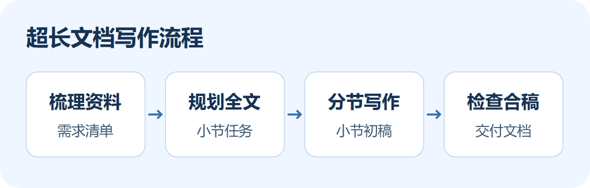
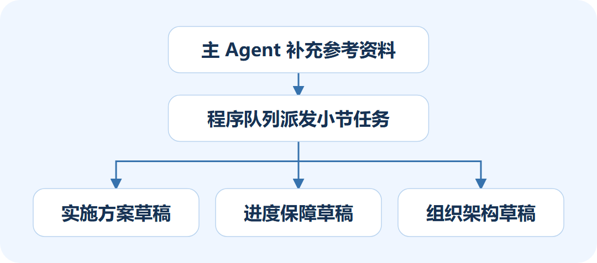
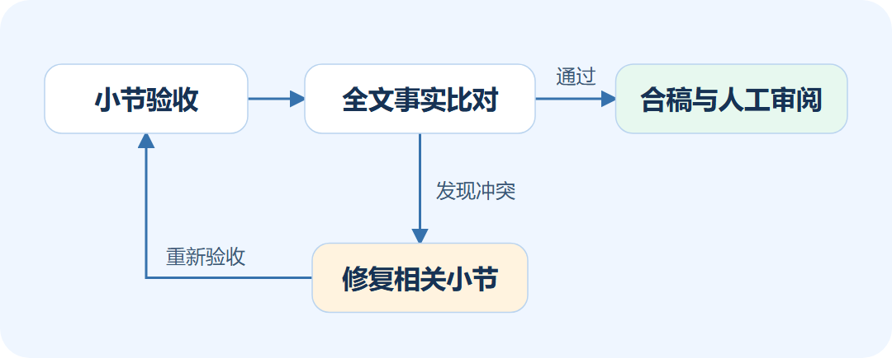

写一篇两千字的文章，给 AI 一个主题和几项要求，通常就能拿到一份初稿。文档长到几十个章节时，写作前就得多做些准备：每章讲什么，要参考哪些资料，哪些信息需要在全文保持一致。

拿标书里的技术方案来说，几百页招标文件里散落着不同的要求，方案要逐项回应，工期和技术参数也会在多个章节反复出现。我们可以先把要求和共同使用的信息梳理清楚，再让 AI 分章写，最后把各章放在一起检查。

## 📋 01｜先从资料里提取写作要求

手里的 PDF、Word 和其他参考资料，可以先转成可处理的文本。资料较长时，让 AI 分段提取，再汇总重复条目，形成一份**需求清单**。每条都带上原文和页码或条款编号，后续写作和审稿时都能回查。

在招标文件里，可以提取三类信息：

- **硬性约束** · 资格和交付条件
- **评分要求** · 方案里要逐条回应的技术评分项
- **项目背景** · 为技术选型提供依据的项目现状

> 📌 比如招标文件给出了工期上限，这一步先把数字和出处记下来，方案具体承诺多少天，留到规划时结合实施能力确定。

## 🧭 02｜确定目录、全局事实和小节任务

有了需求清单，就可以决定每项要求放在哪一章、哪些信息要在全文共用，以及每个小节具体要交出什么。

| 规划层次 | 对后续写作的作用 |
|:--|:--|
| **目录结构** | 确定章节边界，尽可能覆盖关键要求 |
| **全局事实** | 统一工期、技术路线、人员和服务承诺等事实 |
| **小节任务** | 确定重点、篇幅、参考资料和表达形式 |

比如，把「进度保障」评分项分配给对应的小节，把经确认的 90 天工期写入全局事实，再要求这个小节用里程碑表说明各阶段如何衔接。「项目实施方案」也会用到这 90 天，两节各自回答自己的问题，同时引用同一份工期记录。这样，目录里的一个小节就有了明确的写作任务，可以单独交给 AI 执行。

## ✍️ 03｜让主 Agent 调度，并发生成各小节

小节任务定下来后，可以让一个主 Agent 按需查找参考资料，把小节要求、相关材料和全局事实一起交给程序队列。每次模型调用负责写一个小节，相互独立的任务可以并发执行，需要引用前文结论的小节则等前文完成后再写。

假设一份文档有 40 个小节，程序可以在并发上限内调度请求，每完成一节就按章节编号保存。某一节生成失败，可以单独重试。验收时发现某节漏答了一项要求，也能把对应的写作任务找出来，补完这一节再复查。

## 🔍 04｜先验收小节，再核对全文

各节有了初稿，先对照小节任务看该写的内容有没有写到，再把散落在各节的工期、人数和技术参数提取出来，与规划阶段确认的全局事实逐项比对。

> 📌 比如，共享清单里确认的工期是 **90 天**，进度保障一节却写成了 **120 天**。定位到这一节后，还要核对里程碑日期和人力安排，因为它们可能也按 120 天排过。

各节通过检查后，由程序按目录合并正文并统一排版。正式交付前，相关负责人再核实资质、人员安排、履约承诺和关键技术参数。

---

## 💡 写在最后｜让长文档也能局部修改

换成可行性研究或行业报告，这套流程依然适用。需要在多章共用的内容可能是投资假设、市场规模或统计口径。把这些信息的出处和引用位置记清楚，后续发现某个数字需要更新时，就能找到受影响的章节，逐一修改和复查。
