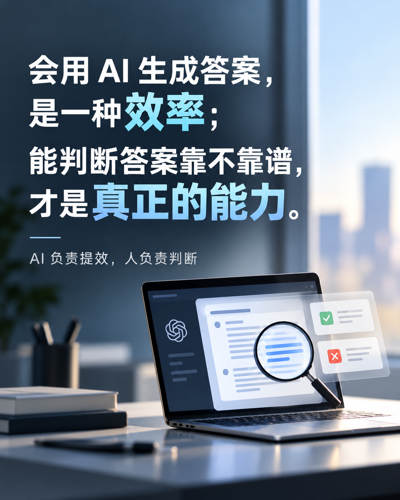
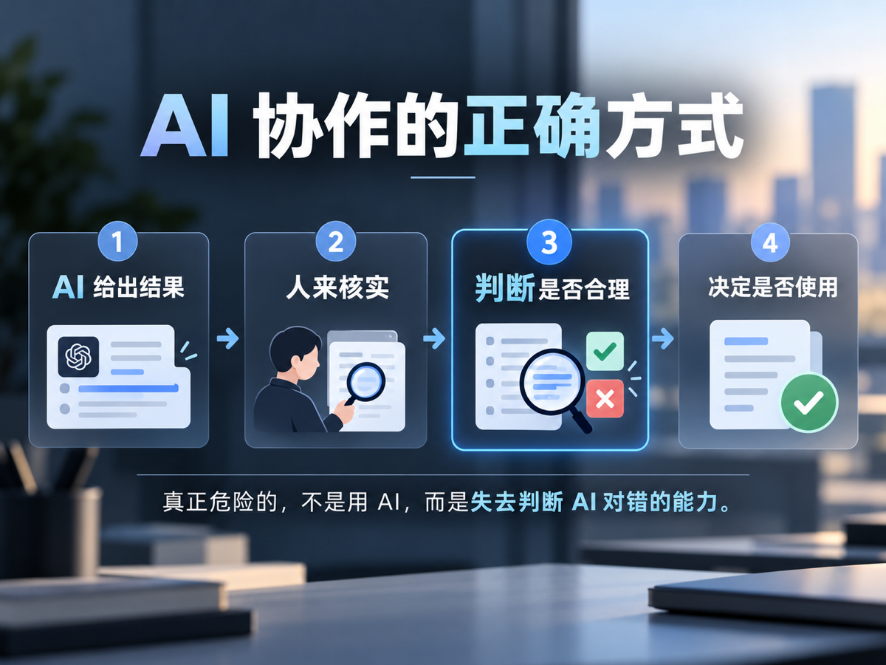

> 💭 **AI 可以替我们做事，但不能替我们判断对错。**

随着 AI 越来越多地进入日常工作，职场中也出现了一种值得关注的现象：有些人习惯把任务交给 AI，拿到生成的内容后，稍作整理便直接使用，却很少停下来判断：**它说得对吗？真的合理吗？**

更让人无奈的是，当被问及具体细节或依据时，得到的回答往往只是轻飘飘的一句：“这是 AI 生成的。”

其实，让 AI 帮忙写方案、整理资料，甚至完成大部分工作，本身都没什么问题。工具能提高效率，为什么不用？

**真正的问题，不是把任务交给 AI，而是把自己的判断力也一并交了出去。**

## 🧠 看起来像答案，不代表就是答案

AI 生成的内容，往往逻辑清晰、措辞专业，读起来似乎很有道理。但表达流畅，不代表事实准确；方案完整，也不代表适合实际场景。

一份方案可能忽略了关键限制，一个结论可能建立在错误的前提上，甚至一些看似具体的数据和依据，也未必经得起核实。

如果只因为内容是 AI 给出的、看起来又足够专业，就不再质疑、不再验证，最后交出去的东西也许连自己都解释不清楚。

## 🤝 AI 负责提效，人负责判断

我们完全可以让 AI 先给出结果，再去审视和完善它。没必要为了证明自己在思考，就坚持每件事都从零开始做。

但拿到结果之后，至少要问自己几个问题：**事实有没有依据？逻辑能否自洽？是否符合真实需求？放到实际工作中能不能落地？**

有疑问，就去查证；有漏洞，就继续追问、修改；超出自己知识范围的，就寻找可靠资料或请懂行的人确认。AI 也可以参与这个检查过程，但**最后不能因为“AI 是这么说的”，就把判断省掉。**

说到底，AI 越强，我们越需要保留的，不是亲手完成每一步的能力，而是**看懂结果、识别问题、作出取舍的能力**。

---

AI 会越来越擅长替我们完成工作，这是好事。但如果长期只负责提问和复制答案，却不再思考它为什么对、又可能错在哪里，真正被削弱的，或许就是独立判断的习惯。

> 🌱 **让 AI 成为得力助手，而不是自己的大脑。**
>
> **所有绕过思考走的捷径，终会变成未来路上最难跨过的坎。**
