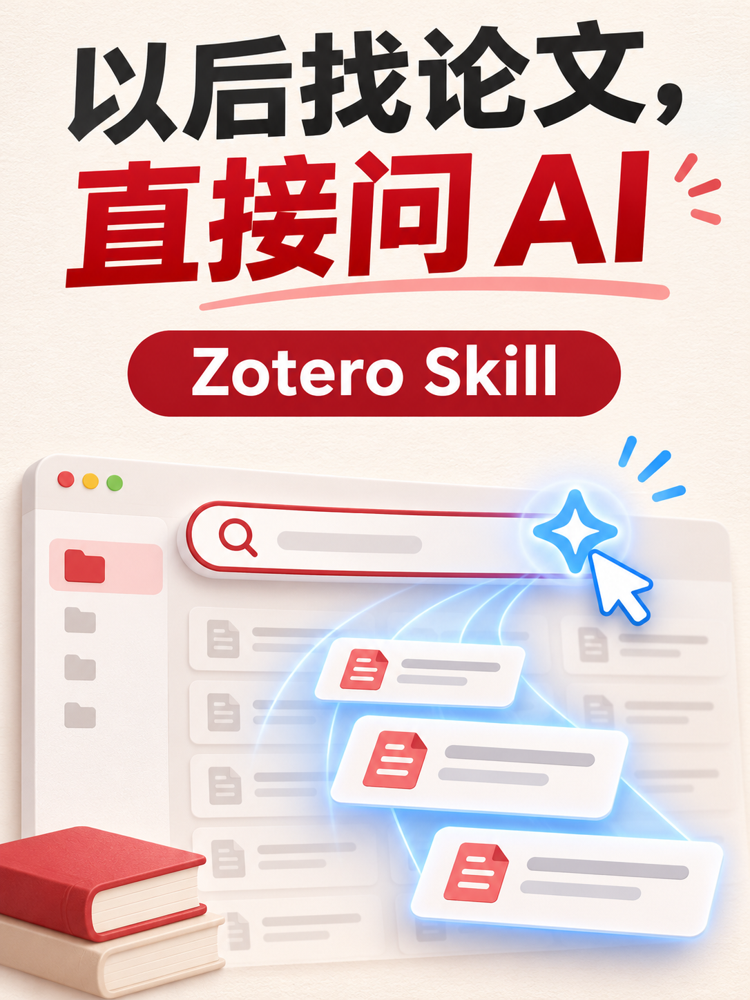

收藏论文很容易，真正要用时却经常找不到😅

明明记得论文讲了什么，却想不起标题和作者，只能在 Zotero 里一篇篇翻。

所以我写了一个 **Zotero Skill**，让 AI 可以直接查询我的本地文献库。

现在，只要告诉 AI 自己记得的内容：

> 帮我在 Zotero 里找一篇论文。我记得它讲的是：微调大模型学习新知识，反而容易产生幻觉。

它就会找到对应论文，并整理出标题、摘要和主要结论。

除此之外，还可以让 AI 查看最近收藏的论文、按作者或标签筛选、读取笔记和全文。

使用也很简单：在 Zotero 设置中允许本机其他应用与它通信，再把 `SKILL.md` 交给 Claude Code 安装就可以了。

不需要额外安装 Zotero 插件，也不用配置 MCP Server。以后找论文，直接问 AI 就行。

想试试的话，评论区留下「Zotero」📩

#Zotero #论文阅读 #科研工具 #AI工具 #文献管理 #ClaudeCode
